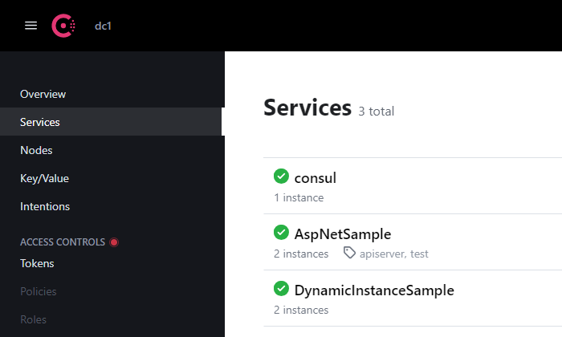
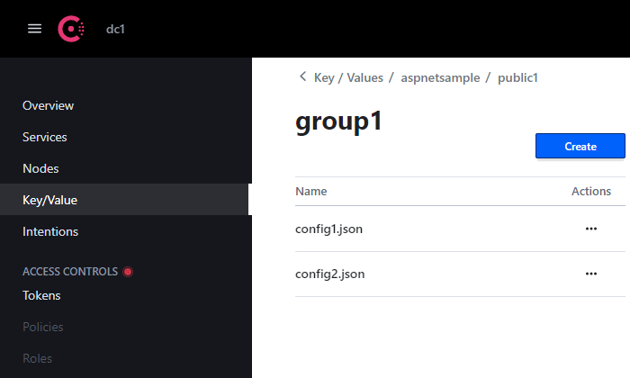

# Alastack.Consul

Alastack.Consul supports Configuration and Service Discovery with Hashicorp Consul.

[](https://github.com/kyzala/AlastackConsul/actions/workflows/dotnet.yml)[](LICENSE)[](https://www.nuget.org/packages/Alastack.Consul)

## Getting started

### Install package from the .NET CLI

```
dotnet add package Alastack.Consul
```

### Configuration and Registration

The following code snippet demonstrates using Configuration and Service Discovery with Hashicorp Consul:

```c#
var builder = WebApplication.CreateBuilder(args);
builder.Configuration.AddJsonFile("consul.json", true, true);
// Add Consul Configuration
builder.Configuration.AddConsulConfiguration();

// Add Consul Registration
builder.Services.AddConsulRegistration(builder.Configuration);
builder.Services.AddControllers();

var app = builder.Build();
// Use HealthCheck Endpoint
app.UseHealthCheck("/health");
app.UseAuthorization();
app.MapControllers();

app.Run();
```

### Dynamic Registration for AspNetCore

```
dotnet add package Alastack.Consul.AspNetCore
```

code snippet:

```c#
// builder.Services.AddConsulRegistration(builder.Configuration);
builder.Services.AddConsulRegistration(builder.Configuration).AddConsulAspNetCore();
```

```JSON
{
  "Consul": {
    "Agent": {
      "Datacenter": "dc1",
      "Address": "http://localhost:8500",
      "WaitTime": "00:00:05"
    },
    "Registration": {
      "Name": "DynamicInstanceSample",
      "Version": "1.0.0",
      "Metadata": {
      }
    }
  }
}
```



## All Config properties

```JSON
{
  "Consul": {
    "Agent": {
      "Datacenter": "dc1", // Default to "dc1"
      "Address": "http://localhost:8500",
      "Token": "045ee828-2fa4-45b7-b01d-d9fb3937da54", // Default to null
      "WaitTime": "00:00:05" // Default to null
    },
    "Configuration": {
      "PathBase": "/dotnet/aspnetsample",
      "Namespace": "public1", // Default to "public"
      "Sets": [
        {
          "Id": "appsettings.json"
          //"Group": "default"
        },
        {
          "Id": "config.json",
          "Group": "group1", // Default to "default"
          "Format": "Json" // Default to "Auto"; resolved from the Id extension when not set
        },
        {
          "Id": "config_other.json",
          "Group": "group1",
          "Optional": true, // Default to false
          "ReloadOnChange": true, // Default to false
          "PollingWaitTime": "00:00:10", // Default to 5s
          "IgnoreException": true, // Default to false
          "Description": "description" // Default to null
        }
      ],
      "Metadata": {
        "MyKey1": "MyValue1",
        "MyKey2": "MyValue2"
      }
    },
    "Registration": {
      "Name": "AspNetSample",
      "Version": "1.0.0", // Default to "1.0.0"
      "Instances": [
        {
          //"Id": "aspnetsample1", // Default to $"{registration.Name}@{registration.Address.Host}:{registration.Address.Port}"
          "Address": "http://localhost:5000",
          "Tags": [ "apiserver", "test", "http" ],
          "EnableTagOverride": true, // Default to false
          "HealthCheck": {
            //"CheckId": "AspNetSample_HealthCheck1", // Default to $"service:{options.Registration.Id}"
            //"Name": "AspNetSample_HealthCheck", // Default to $"Service '{options.Registration.Name}' check"
            "DeregisterCriticalServiceAfter": "00:01:00", // Default to "00:01:00"
            "Interval": "00:00:15", // Default to "00:00:15"
            "Endpoint": "/health", // or absolute uri: http://127.0.0.1:5000/health
            "Timeout": "00:00:10" // Default to "00:00:10"
          }
        },
        {
          "Address": "https://localhost:5001",
          "Tags": [ "apiserver", "test", "https" ],
          "EnableTagOverride": true // Default to false
        }
      ],
      "DefaultHealthCheck": {
        "DeregisterCriticalServiceAfter": "00:01:00",
        "Interval": "00:00:15",
        "Endpoint": "/health",
        "Timeout": "00:00:10"
      },
      "Metadata": {
        //"RegistrationIdNullPolicy": "Default" // or "Consul"
      }
    }
  }
}
```

### Configuration in Consul Key/Value store

Configuration values are loaded by [Alastack.Extensions.Configuration.Consul](https://www.nuget.org/packages/Alastack.Extensions.Configuration.Consul), a low-level configuration source that maps a single Consul KV key to one configuration document (JSON, INI or XML). `Alastack.Consul` builds on it and only adds the application-level path convention.

**Path key:** 
`{Configuration.PathBase} / {Configuration.Namespace} / {Set.Group} / {Set.Id}`

**Format** is resolved in this order:

1. `Set.Format` when set explicitly;
2. otherwise the `Set.Id` extension (`.json`, `.ini`, `.xml`);
3. otherwise an `InvalidOperationException` is thrown.

YAML is not supported yet.



## Samples

Visit the [samples](https://github.com/kyzala/AlastackConsul/tree/main/samples) folder.

## Migrating from 1.2.x to 1.3.0

1.3.0 contains breaking renames. Update code and configuration keys as follows.

**Code**

| 1.2.x | 1.3.0 |
| --- | --- |
| `ConsulOptions` | split into `ConsulConfigurationOptions` and `ConsulRegistrationOptions` |
| `ServiceRegistration` | `ConsulRegistrationOptions` |
| `ServiceRegistrationExtentions` | `RegistrationExtensions` |
| `AgentConfiguration` | `AgentOptions` |
| `AppConfiguration` | `ConsulConfigurationOptions` |
| `AppConfigurationDefaults` | `ConfigurationDefaults` |
| `RegistrationInstance` | `ServiceInstance` |
| `ServiceHealthCheck` | `HealthCheckOptions` |
| `ServiceRegistration.HealthCheckDefault` | `ConsulRegistrationOptions.DefaultHealthCheck` |
| `HealthCheckOptions.Health` | `HealthCheckOptions.Endpoint` |
| `IRegistrationService.ServiceRegister` / `ServiceDeregister` | `RegisterAsync` / `DeregisterAsync` |
| `ConsulOptions.IsEnabled` | removed, it was never read |
| `AddConsul()` | `AddConsulRegistration()` |
| `AddAspNetCore()` | `AddConsulAspNetCore()` |
| `IServerAddressesHandler` | `IServerAddressesProvider`, read-only; `Configured` / `AddServerAddress` are no longer part of the contract |
| `RegistrationExtensions`, `ConsulRegistrationPostConfigureOptions` | removed; options are read-only after binding, instance defaults are applied when instances are resolved |
| AspNetCore `Defaults.ServerAddressTimeout` | `RegistrationDefaults.ServerAddressesTimeout` (main project); the new public `DefaultServerAddressesProvider` lives in `Alastack.Consul.Registration` |

`RegistrationService`, `ConsulRegistrationHostedService` and `ServerAddressesFilter` are now internal. Resolve `IRegistrationService` and `IServerAddressesProvider` through dependency injection instead of constructing them.

**Configuration keys**

| 1.2.x | 1.3.0 |
| --- | --- |
| `"HealthCheckDefault"` | `"DefaultHealthCheck"` |
| `HealthCheck."Health"` | `HealthCheck."Endpoint"` |
| `"IsEnabled"` | removed |

## Migrating from 1.3.1 to 1.4.0

Configuration loading moved to a separate package, `Alastack.Extensions.Configuration.Consul`, which replaces the
`Winton.Extensions.Configuration.Consul` dependency. No configuration file changes are required.

**Code**

| 1.3.1 | 1.4.0 |
| --- | --- |
| Configuration loading via `Winton.Extensions.Configuration.Consul` | `Alastack.Extensions.Configuration.Consul` (transitive dependency of `Alastack.Consul`) |
| `ConfigurationSet.Format` | added; `Auto` (default) resolves the format from `Id` |

If you use the configuration source directly, the low-level API is available as `builder.AddConsul(path, source => ...)`
with the public `ConsulConfigurationSource` / `ConsulConfigurationProvider` types.
